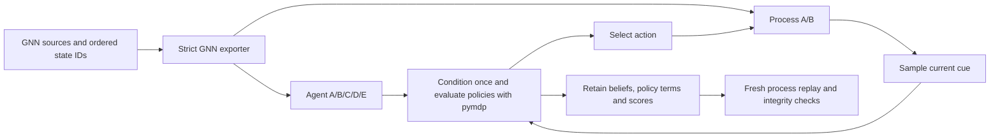

# Cascadia: separate the agent model from the process

For a portable registry and an ordered selection of these cases, use the
[configured model matrix](cascadia_model_matrix.md). It shares a seed/horizon
contract and retains each real pair edition in one closed experiment.

The closed-loop runner executes real `inferactively-pymdp` 1.0.4 inference and
policy evaluation from a validated GNN artifact. Its optional
`process_artifact` supplies the sampled observation and transition laws.
The default remains a matched agent/process simulation.

## What is computed

For an observation at the current true state, the process samples
$o_t\sim A_P[:,s_t]$. The agent conditions once:

$$q_t(s)=\frac{A_Q[o_t,s]q_t^-(s)}{\sum_j A_Q[o_t,j]q_t^-(j)}.$$

Real pymdp scores one-step policies using expected utility and state information
gain, then selects an action using the agent's habit $E_Q$. The process samples
$s_{t+1}\sim B_P[:,s_t,a_t]$, while the agent predicts
$q_{t+1}^-=B_Q[:,:,a_t]q_t$. These are different operations. Process C/D/E
do not control the agent: the explicit initial true state supplies the process
start, while agent D supplies its initial belief.



Carrier, state order, dimensions and physical clock must match before execution.
The categorical schema does not label observation or action indices. Their
shared meanings remain an explicit modelling assumption; equal dimensions do
not establish it. The Cascadia compiler supplies the same ordered cue/action
alphabets for its reference and degraded-odor variants.

## Run and recheck

Use a new output directory and artifacts reproduced by GNN's own exporter:

```bash
uv run python GEO-INFER-ACT/examples/cascadia/run_model_pair.py \
  --agent STUDY/reference/smith_river_homing.geo-infer.json \
  --process STUDY/uninformative_odor/smith_river_homing.geo-infer.json \
  --initial-state 0 --steps 48 --seeds 0 7 --output PAIR_EDITION
uv run python GEO-INFER-ACT/examples/cascadia/run_model_pair.py --check PAIR_EDITION
uv run python GEO-INFER-ACT/examples/cascadia/run_model_pair.py \
  --check PAIR_EDITION --replay
```

The first command retains both exact artifacts, a design and attempt record,
each real trajectory, all policy terms, observation-time scores and a manifest.
No successful manifest is written after an impossible cue, numerical identity
failure or source drift. Existing editions are refused.

The default recheck verifies file integrity relative to the supplied manifest,
not authenticity. `--replay` checks the six named execution owners and supported
pymdp version, executes both process and agent again, and compares trajectories,
policy terms, scores and summaries. It does not authenticate the original
export or inventory every dependency byte. Reproduce each input separately
with GNN's `docs/other/geo_infer/qualify_export.py`.

## Compare assumptions without conflating them

The [retained comparison](../examples/cascadia/data/model_pairs_20261013.html)
ships four actual pair editions, each with seeds 0 and 7 and 48 observations.
Its manifests bind canonical inputs, six execution owners and every retained
numerical file. The [SVG](../examples/cascadia/data/model_pairs_20261013.svg)
shows all selected seeds. These are descriptive executions of the declared
models; the seed grid does not establish a population effect.

The October 13 HTML retains its captured display bytes. For the current mobile
layout and matrix-level owner binding, use the newer
[matrix edition](cascadia_model_matrix.md). Pair replay still checks the numerical
records independently of that display-template change; rerender old pair
comparisons into a new file before checking current HTML freshness.

The complete records are in
[model_pairs_20261013.zip](../examples/cascadia/data/model_pairs_20261013.zip).
Extract the archive into a new output directory before running the pair replay
or comparison commands. Each case directory has its own closed manifest;
comparison HTML and SVG are outside those case directories.

| Agent | Process | Interpretation |
| --- | --- | --- |
| Reference | Reference | Matched baseline |
| Degraded odor | Degraded odor | Matched process with less informative cues |
| Reference | Degraded odor | Agent expects the reference cue law |
| Degraded odor | Reference | Agent uses a less informative cue model |

Use the same named seed grid and horizon, and retain every result. Common RNG
seeds are reproducibility controls, not identical physical histories: actions
and observation distributions can diverge. Posterior Brier scores and entropy
describe these simulated records; they are not held-out predictive calibration.
No mismatched condition inherits a reference native certificate or ecological
validity claim. See [the workflow](cascadia_workflow.md) and
[diagnostic units and bounds](cascadia_diagnostics.md).

## Generate or check a comparison

Select editions explicitly in the order you want the legend and table to use.
The HTML producer checks a closed file roster before parsing finite scores,
and requires the same ordered seeds, horizon and physical clock. It displays
the exact recorded values and manifest/model digests. It performs no numerical
replay; use the separate `run_model_pair.py --check ... --replay` command first
when current execution evidence is needed.

```bash
uv run python GEO-INFER-ACT/examples/cascadia/plot_model_pairs.py \
  --editions PAIR_REFERENCE PAIR_MISMATCH --output comparison.svg
uv run python GEO-INFER-ACT/examples/cascadia/plot_model_pairs.py \
  --editions PAIR_REFERENCE PAIR_MISMATCH --html --output comparison.html
uv run python GEO-INFER-ACT/examples/cascadia/plot_model_pairs.py \
  --editions PAIR_REFERENCE PAIR_MISMATCH --html --check --output comparison.html
```

Generation is create-only. The HTML freshness check compares exact deterministic
bytes and never repairs the output. A stale file, duplicate score key, nonfinite
score or misaligned recorded clock fails. The template ships in the ACT wheel;
the same API works in an installed package without a source checkout.

## GitVault environments

Before source work, check resolved `sys.prefix` and `sys.base_prefix` using
`uv run --no-sync python`; both must be on the mounted volume. Bind
`UV_PROJECT_ENVIRONMENT` to the selected repository environment and keep
`TMPDIR`, `UV_CACHE_DIR`, `XDG_CACHE_HOME` and `MPLCONFIGDIR` on GitVault.
Export GNN artifacts with its separate supported interpreter. Preserve original
environments and Python versions when creating a new task environment.
