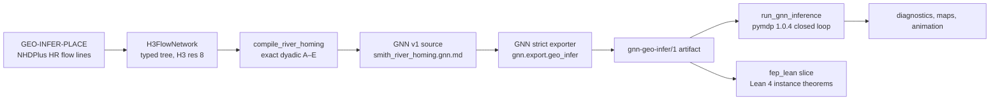

# Cascadia river homing: typed geospatial active inference with GNN and Lean

An adult salmon returns from the Pacific up the lower Smith River in Del
Norte County, California, and has to find its natal tributary, Rowdy Creek.
The fish never sees its own position. It senses a noisy habitat cue and a
noisy trace of natal-stream water, and it chooses one of four moves every
six hours. This page documents that example end to end: one generative model
expressed three times, as typed Python over real H3 geometry, as a GNN v1
specification exported through GNN's strict exporter, and as a Lean 4
instance whose theorems are checked against the exported artifact itself.

The model is illustrative. Its cells and flow relations come from measured
USGS hydrography; its habitat classes, odor levels, movement probabilities
and preferences are declared assumptions, not parameters fitted to fish
telemetry.

## Three representations of one model



| Plane | Owner | Establishes | Does not establish |
| --- | --- | --- | --- |
| Typed implementation | GEO-INFER-ACT | Cells, relations and cue fields compiled from real geometry; deterministic closed-loop execution through the public contract | Mathematical proof; ecological validity |
| Notation | GNN | A strict extractor accepts the source, verifies the B axis order from the data, and validates the H3 identifiers | Runtime behavior of any consumer |
| Formal | fep_lean | Lean checks the exported tables and proves light-cone, arrival, Bayes and pymdp-bridge theorems about them | Anything about float32 execution, H3 geometry beyond the recorded adjacency table, or salmon |

The three planes exchange bytes, not imports: GEO-INFER renders the GNN
source, GNN exports the artifact in its own environment, and fep_lean reads
retained byte copies. Each repository validates its own copy.

## Typed state space

`geo_infer_act.core.h3_flow_network` traces flow-ordered lines (NHDPlus HR
`flowdir` equal to 1) onto one H3 resolution. Consecutive cells along a line
become directed edges; a step that skips a cell is filled with the H3 grid
path, so every edge joins H3 neighbors. `compile_flow_network` then selects a
typed tree draining to one sea cell:

- **main stem**: from the outlet upstream along the largest-discharge
  predecessor while mean annual flow stays at least 1000 cfs;
- **sea**: the outlet neighbor farthest past the coastline;
- **side channels**: every stream joining the main stem, walked upstream by
  discharge; the named natal stream gets four cells, estuary sloughs one,
  other tributaries three.

`H3FlowNetwork` stores three relations: `successor` (downstream),
`upstream` (continuation of the same stream) and `side` (the stream joining
at a cell). Construction fails unless every relation joins H3 neighbors, the
tree is acyclic with a single sea terminal, and every upstream or side cell
drains back into its parent.

On the retained 59-feature excerpt (HUC8 18010101) at resolution 8 the
network has 26 cells: the sea, 16 main-stem cells from the mouth upstream,
two estuary sloughs, three cells of lower Tryon Creek and four of lower
Rowdy Creek. Tryon Creek joins below Rowdy Creek, so a fish that turns too
early enters the wrong stream.

## Cues, actions and preferences

`geo_infer_act.models.river_homing` compiles exact matrices from the typed
network. Every probability is a dyadic fraction, so its decimal literal is
an exact binary64 value.

| Element | Definition |
| --- | --- |
| Observation | 12 outcomes, `3 * habitat + odor`; habitat is marine, estuary, river or creek; natal odor is none, faint or strong |
| Habitat class | sea is marine; the mouth, the next two main-stem cells and the sloughs are estuary; other main-stem cells are river; tributaries are creek |
| Odor level | strong in Rowdy Creek, at its confluence and one cell below; faint along the rest of the plume to the sea; none elsewhere, including Tryon Creek |
| Habitat cue | correct with probability 3/4, otherwise an adjacent class |
| Odor cue | correct with probability 7/8 (none, strong) or 3/4 (faint), otherwise an adjacent level |
| `hold` | stay with probability 3/4, drift one cell downstream with 1/4 |
| `downstream` | move to the successor with probability 3/4 |
| `upstream` | continue up the current stream with probability 1/2 |
| `turn` | enter the stream joining here with probability 1/2; stay if none joins |
| C (nats) | odor none −2, faint 1, strong 2; creek with strong odor (home) 4 |
| D | sea 3/4, mouth 1/4 |
| E (habit) | hold 1/8, downstream 1/8, upstream 1/2, turn 1/4 |
| Time step | 21600 s (six hours) |

The likelihood denominators are 64 for A, 4 for B, 4 for D and 8 for E.

## The GNN specification

`CategoricalGNNSpec.render` writes canonical GNN v1 Markdown with explicit
A–E literals, `b_tensor_order: next_state_previous_state_action`, and a
`## Time` section declaring `StepSeconds=21600` and `SpaceKind=h3`. GNN's
strict exporter accepts the source, detects the B axis order from the data
(no prose declaration can substitute), validates the H3 state identifiers at
one resolution, and binds the artifact to the source's SHA-256. GNN's
notation-derived metadata reads the same step and space kind from the
`## Time` section.

The committed fixtures in `examples/cascadia/data/` are the rendered source,
the state-ID order, the typed-network sidecar, the GNN-exported artifact and
the export provenance record (GNN revision, command and digests).

## Running it

From the repository root:

```bash
# From the committed artifact (checks that every fixture is fresh first)
uv run python GEO-INFER-ACT/examples/cascadia/cascadia_homing.py

# Re-export through GNN in its own environment and rewrite the fixtures
uv run python GEO-INFER-ACT/examples/cascadia/cascadia_homing.py \
  --gnn-repo ../Generalized_Notation_Notation \
  --gnn-python ../Generalized_Notation_Notation/.venv/bin/python \
  --refresh-fixtures
```

Without `--gnn-repo` the run refuses stale fixtures: the compiled source,
state IDs and sidecar must match the committed bytes, and the artifact must
carry the source digest and exactly the compiled matrices. Outputs go to
`GEO-INFER-ACT/examples/outputs/cascadia_homing/` (ignored by Git) with a
`run_manifest.json` listing every file's SHA-256 and the Python, pymdp, JAX,
jaxlib, h3 and NumPy versions that produced them. pymdp scores policies in
JAX float32, so a different JAX build can move the float diagnostics by about
1e-7 while the exact first update, the discrete trajectory and the homing
events stay identical.

`run_closed_loop` samples observations and true moves from the artifact's own
A and B. Each step runs the public `run_gnn_inference` contract on that step
alone, with the current predictive prior as D. A final replay of the complete
observation record through `run_gnn_inference` with the artifact's own D must
reproduce every action and belief exactly, or the run raises.

| Output | Content |
| --- | --- |
| `closed_loop.json` | True states, observations and the replayed contract trace |
| `diagnostics.json` | Per-step entropy, free energy, true-cell mass and each policy's risk, ambiguity and EFE, with the pymdp identity gap |
| `summary.json` | Homing events, light-cone checks, exact first update, decision margin |
| `figures/` | Cascadia context, typed network, belief snapshots, free-energy trace, EFE decomposition, light cone, belief GIF and MP4 |

## What the reference run shows

With process seed 7, the fish moves from the sea into the river at step 1,
enters Rowdy Creek at step 23 (138 hours) and reaches the uppermost selected
Rowdy cell at step 26. It never enters Tryon Creek or a slough. Near the
Rowdy confluence `turn` has the lowest risk; when the fish is unsure whether
it has reached the confluence it alternates `turn` and `upstream`, and its
belief over cells spreads along the uniform-looking main stem until the odor
cue sharpens. Once in Rowdy Creek its posterior concentrates on the true cell.
The smallest margin between the two most probable policies over the whole run
is about 0.03, far above float32 noise, so the trajectory does not depend on
near-ties. The integration tests pin these events.

Two exact facts cross-check the planes. The first observation is marine with
faint odor; its evidence is 57/128 and the exact posterior on the sea cell is
18/19. The contract's float posterior equals 18/19 to machine precision, and
Lean proves the same value from the exported tables. For every belief and
policy, pymdp 1.0.4's negative expected free energy equals
`log Σ exp C − (risk + ambiguity)`. Along the run the largest gap between
pymdp's float32 report and that expression stays below 10⁻⁵.

## The Lean formalization

The fep_lean slice `fep_lean/specs/cascadia-geo-act-proof/` (a prose path
in the sibling checkout) reads byte copies of these fixtures, generates
`SmithRiverHoming.lean` with the artifact's tables as exact naturals over
their denominators, and compiles it natively against the pinned Mathlib.
Among its theorems:

| Theorem | Statement |
| --- | --- |
| `plannedState_support` (general) | Every open-loop plan of relation-local kernels predicts zero mass outside the reachable cone of the prior support |
| `riverStep_h3Adjacent` | Every river move joins cells adjacent in the recorded H3 table |
| `homing_lower_bound` | No plan of fewer than 13 steps predicts positive mass at home, whatever its actions |
| `homing_bound_tight` | The 13-step plan (nine upstream, one turn, three upstream) reaches home with positive mass |
| `first_posterior_sea` | After the first observation the exact posterior on the sea cell is 18/19 |
| `efe_bridge`, `policy_posterior_bridge` | Risk plus ambiguity equals `log Σ exp C` minus pymdp's score, and pymdp's policy posterior is the control posterior of risk plus ambiguity, for every belief |
| `cascadiaDoc_wellFormed`, `cascadiaDoc_dims` | The GNN source transcribes to a well-formed Q1 document whose declared dimensions are the carrier cardinalities |
| `cascadiaDoc_not_discreteConforms` | The source binds C to log-preferences, so fep_lean's normalized-C denotation does not apply; the `softmax C` carrier is the bridge |

The existing fep_lean decomposition of expected free energy into risk plus
ambiguity assumes every predicted state and outcome has positive mass. A
spatial belief is sparse: most cells carry exactly zero mass, which is the
content of the light cone. The bridge theorem needs only that `softmax C` is
positive, which always holds.

The verification receipt also compiles four mutated instances that must fail:
transposed B axes, one H3 adjacency edge removed, an arrival bound one step
too strong, and a wrong posterior. Each is rejected by Lean.

## Checks

```bash
uv run python -m pytest GEO-INFER-ACT/tests/unit/test_h3_flow_network.py \
  GEO-INFER-ACT/tests/unit/test_gnn_spec.py \
  GEO-INFER-ACT/tests/unit/test_efe_decomposition.py \
  GEO-INFER-ACT/tests/integration/test_cascadia_river_homing.py -q
```

The GNN-side tests (`tests/export/test_geo_infer_cascadia.py` in the GNN
checkout) re-export the same source byte for byte and reject a transposed
transition literal. The fep_lean checks are the slice's
`generate_probe.py --check` and `verify_native.py`.

## Limits

- The habitat and odor rules are declared modeling assumptions applied to
  network position; they are not measured salinity or chemistry.
- One-step policies make the agent myopic: progress along stretches with
  identical cues comes from the upstream-biased habit, not from planning.
- The Lean theorems are about the exported finite model. They prove nothing
  about pymdp's float32 arithmetic, about H3 geometry beyond the recorded
  adjacency table, or about real fish.

## Further reading

- [GNN and GEO-INFER interchange](./gnn_interchange.md): the contract this example exercises
- [fep_lean notation bridge](./fep_lean_notation_bridge.md): construct-level correspondence rows
- [Geospatial applications](./geospatial_applications.md): other ACT spatial workflows
