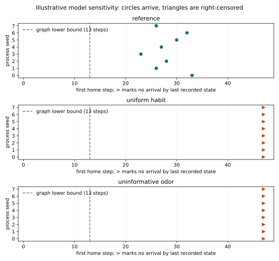

# Cascadia seed and assumption study: 2026-10-12

This retained edition runs the same 26-cell illustrative Smith River model
under three exact assumption conditions. It complements the reference
trajectory and its Lean instance; the variants have **no native proof receipt**.
See [the experiment contract](cascadia_river_homing.md#seed-and-assumption-sensitivity)
for condition definitions, censoring, numerical qualification and reproduction.

## Observed outcomes

Eight process seeds (0 through 7), agent seed 0, and 48 observations are used
for each condition: 24 trajectories and 1,152 observed inference steps.
All trajectories pass exact contract replay and the numerical support/EFE
checks. None is excluded for failing to reach home.

| Condition | Home arrivals | Right-censored | Restricted mean first-home step |
| --- | ---: | ---: | ---: |
| Reference | 8/8 | 0/8 | 28.125 |
| Uniform habit | 0/8 | 8/8 | 47 |
| Uninformative odor | 0/8 | 8/8 | 47 |

The reference arrivals occur at steps 33, 26, 28, 23, 27, 30, 32 and 26 in
seed order. A null arrival is censored at the last observed state, step 47;
47 in the restricted-mean column is not an observed arrival. These are
descriptive outcomes for the declared finite model and seed grid, not an
ecological homing rate or a confidence interval. The odor condition also
changes cue frequencies, so it does not isolate information value under a
preserved marginal observation distribution.



The largest pymdp identity gap across all conditions is below 10^-5. The
uniform-habit condition has a minimum policy-posterior decision margin of
approximately 5.87 x 10^-6; that near tie is retained. The uninformative-odor
condition's minimum margin is approximately 0.177, so its non-arrival cannot
be summarized as a policy-tie observation. Read the
[exact machine summary](../examples/cascadia/data/cascadia_seed_study_20261012_summary.json)
for the unrounded measurements.

## Retained custody

- [Full study ZIP](../examples/cascadia/data/cascadia_seed_study_20261012.zip):
  every seed's trace, diagnostics, summary and outcome; each condition's source,
  domain, state order, GNN artifact and export record; PNG/SVG figures; frozen
  source owners; design and study manifest.
- [Manifest copy](../examples/cascadia/data/cascadia_seed_study_20261012_manifest.json):
  bound file digests, source ownership, runtime versions and qualification.
- ZIP: 2,203,962 bytes, SHA-256
  `eb9dc83fd91b0f6e366169442eccb5e15776f95982625443a3e770474b51f220`.
- GEO-INFER source revision:
  `1e04c7bfa501917c30e42a3e0cd18a7e32f034e8`.
- Each GNN export records
  `15abd4b52c48a94390b421c75a145ab28c47de33`, with clean exporter source owners.
- Runtime: Python 3.12.11, pymdp 1.0.4, JAX/jaxlib 0.4.38, NumPy 1.26.4,
  H3 4.5.0, Pydantic 2.11.7.

All 149 frozen code and dependency-owner files match the named GEO-INFER
revision byte for byte. The manifest honestly retains `workspace_dirty: true`:
concurrent documentation generation changed `manuscript/config.yaml`; its
simulation owners did not change. The final source-drift list is empty, and
read-only validation against the live checkout passes. The archived config
is a custody snapshot whose data paths were originally relative to the
reference example; use the maintained example config when generating a new
study from a checkout.

Extract into a new directory, then check the retained bytes and summaries:

```bash
mkdir GEO-INFER-ACT/examples/outputs/cascadia_retained_check
uv run python -m zipfile -e \
  GEO-INFER-ACT/examples/cascadia/data/cascadia_seed_study_20261012.zip \
  GEO-INFER-ACT/examples/outputs/cascadia_retained_check
uv run python GEO-INFER-ACT/examples/cascadia/validate_study.py \
  GEO-INFER-ACT/examples/outputs/cascadia_retained_check/cascadia_seed_study_20261012_final \
  --geo-infer-root .
```

This static check is not a new execution. Generate a new seed-study edition
to repeat the simulation with the named environments. Later owner changes
can make the optional live comparison fail while the archived edition remains
an intact historical record.

## Verification and retained failures

- Full ACT runner: 683 tests pass, zero empty selections, and the descendant
  ownership gate passes. macOS 27 checks use the documented native PyTensor
  compiler profile. Focused study, custody and documentation-pin tests also pass.
- Pydantic is declared in ACT's `examples` extra. The lockfile resolves without
  changing dependency versions, and the built wheel's actual metadata contains
  that extra and its Pydantic requirement. Ruff, formatting, mypy, packaging,
  repository contracts, logging hygiene and generated signposts pass.
- The manuscript generator's seven verification groups pass and regenerate
  inventory, figures and resolved documentation. These checks are distinct
  from the full ACT runner and the simulation study.
- GNN's eight reference-export tests pass. fep_formal's reference Cascadia
  receipt validates 46 statements and rejects four mutations; its separate
  168-topic native catalogue receipt is claim-ready for its bound source.
- The first exporter attempt failed on relative paths; the second resolved
  the virtualenv interpreter's symlink and lost that environment. Both partial
  directories and the second traceback are retained locally. The final runner
  makes paths absolute while preserving the interpreter's virtualenv path.
- The first full ACT attempt passed its tests but failed ownership because the
  new temporary Git fixture started a filesystem-monitor daemon. A focused
  two-test probe reproduced the failure. Disabling the monitor in that temporary
  repo makes the same strict gate pass; no global Git setting or ownership gate
  was weakened. Failed and successful receipts remain under ignored
  `examples/outputs/cascadia_study_validation*` and
  `examples/outputs/cascadia_custody_*_probe`.

LectureCreate's existing 15-minute reference video remains a separate frozen
edition. Its metadata handoff now explains that distinction. Hosted
LectureCreate jobs are blocked by an Actions budget; its verified local
production receipt is not represented as hosted success. The previously
observed workspace-wide ecCodes/eccodeslib dependency gap is also separate
from the passing Cascadia execution and affected checks.
