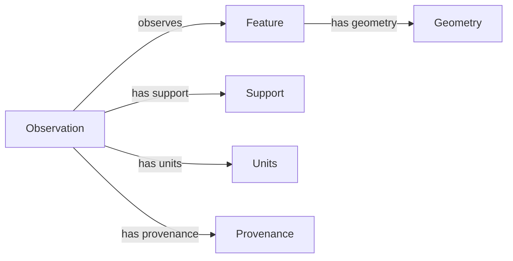

# Ontology Visualization Concepts

A vocabulary diagram helps readers inspect concepts and relationships. It does
not by itself validate ontology axioms or demonstrate that a knowledge-base
service exists. INTRA's implemented renderers produce **illustrative module
previews**, not an interactive ontology editor or a graph-reasoning dashboard.

## Choose a view for the question

| View | Useful for | Interpretation limit |
| --- | --- | --- |
| Class hierarchy | Reviewing broad/narrow concepts | Multiple inheritance may require a graph rather than a tree |
| Relationship graph | Inspecting selected predicates | A drawn edge is not proof of an evaluated geometric relation |
| Property table | Reviewing units, definitions, and cardinality | A documented constraint still needs an implementation |
| Geographic map | Inspecting geometry and support | Proximity does not establish a semantic or causal relation |
| Change comparison | Reviewing revised definitions and mappings | Stable labels can conceal changed meanings |

Label asserted and derived relationships differently, show the vocabulary
revision, and explain omitted or filtered nodes. Use readable labels, accessible
color choices, and a text/table alternative. Large graphs often need a scoped
view rather than a diagram that claims to display everything legibly.

## Conceptual relationship diagram

This Mermaid diagram is a documentation illustration, not an exported runtime
ontology or a schema enforced by GEO-INFER:



Keep a feature's identity distinct from its geometry. Retain the geometry and
predicate versions when a relationship is computed. See
[spatial concepts](spatial_concepts.md) for coordinate order and boundary
semantics.

## Generate actual module previews

The following executable Python example uses INTRA's shipped renderer:

```python
import json
from pathlib import Path
from geo_infer_intra import generate_module_preview_suite

artifacts = generate_module_preview_suite("INTRA", Path("output/ontology-guide-preview"))
manifest = json.loads(artifacts.manifest_path.read_text())
assert manifest["provenance"]["data_kind"] == "illustrative"
assert len(manifest["artifacts"]) == 3
assert all(row["sha256"] and row["bytes"] > 0 for row in manifest["artifacts"])
```

The HTML, SVG, and PNG files use real H3 cell geometry and a fixed module
profile. They contain no measured ontology dataset or inferred graph. The JSON
manifest records provenance and artifact hashes. Interactive HTML references
external Leaflet resources and map tiles; the static fallback remains separate
from any remote resource availability.

For actual semantic graph visualization, select an external renderer or editor,
provide explicit graph data, pin its dependencies, and retain the input graph,
filter settings, layout settings, and output bytes. Do not treat INTRA preview
success as qualification of that external stack.

## Review before publication

Check labels and legends, clipping, node/edge omissions, text alternatives,
coordinate support, and the distinction between measured, inferred, and
illustrative content. Preserve the input revision and output digest so a visual
review refers to the exact published bytes. For the manuscript's separate
figure and publication workflow, use
[research artifacts](../integration/research_artifacts.md).
