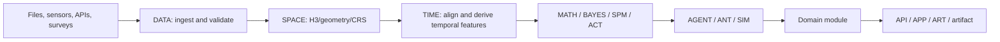

# GEO-INFER Framework Overview

GEO-INFER is a 45-module Python 3.11+ workspace for geospatial analysis,
probabilistic inference, Active Inference, domain workflows, applications, and
repository validation. It treats spatial systems as data-rich processes whose
states, uncertainty, observations, and decisions can be analyzed together.

## What the framework provides

- **Spatial representation** through H3 v4, CRS-aware geometry, indexing, and
  backend dispatch.
- **Temporal representation** through time-series alignment, forecasting, and
  temporal features.
- **Inference** through mathematical utilities, Bayesian models, spatial
  statistics, and the canonical ACT Active Inference implementation.
- **Decision and simulation** through agent coordination, swarm optimization,
  scenario execution, and domain-specific action models.
- **Delivery surfaces** through APIs, dashboards, visualization, communication,
  security, and operations modules.
- **Release evidence** through strict repository, test, model, skill, source,
  and H3 contract validators.

## A typical analysis

Not every workflow uses every stage. Choose the module that owns the behavior,
then use public exports and explicit cross-module adapters.

## Module families

| Family | Modules | Responsibility |
| --- | --- | --- |
| Foundations | MATH, SPACE, TIME, DATA | mathematical, spatial, temporal, and data primitives |
| Inference | ACT, BAYES, AI, COG, SPM | probabilistic models, learning, cognition, and spatial inference |
| Decisions | AGENT, ANT, SIM | agents, optimization, and scenarios |
| Domains | AG, BIO, CLIMATE, CIV, ECON, EDU, EMERGENCY, ENERGY, FOREST, HEALTH, LOG, MARINE, PEP, RISK, TRANSPORT, WATER | applied spatial-domain workflows |
| Delivery | API, APP, ART, COMMS, IOT, PLACE | services, dashboards, visualization, messaging, sensors, and place context |
| Governance and tooling | EXAMPLES, GIT, INTRA, METAGOV, NORMS, OPS, ORG, REQ, SEC, TEST | integration, governance, operations, documentation, security, and validation |

See the [module catalog](modules/index.md) for source-backed links and the
root [README module index](../../README.md#module-index) for live inventories.

## Cross-cutting contracts

### Coordinates and H3

H3 boundaries use WGS84 latitude/longitude degrees in (lat, lng) order.
Projected coordinates must be transformed before H3 indexing or metric
operations. The supported H3 package range is h3>=4.5.0,<5.

### Inference and numerical results

Probability vectors and matrices must be finite, non-negative, and normalized
where the API requires probabilities. Covariance and precision updates must
remain finite and symmetric. Stochastic paths accept local seeds when
reproducibility is required.

### Artifacts

Scenario and visualization writers must create their configured output
directories, keep outputs out of the repository root, and provide machine-readable
sidecars or manifests when the validator requires them.

### Documentation

Root and module README/AGENTS files are generated signposts.
Conceptual guidance lives in INTRA docs; executable claims should be backed by
source, tests, or a validator command.

## Where to go next

- [Getting Started](getting_started/index.md)
- [Architecture](architecture/index.md)
- [Active Inference guide](active_inference_guide.md)
- [H3 v4 guide](geospatial/data_formats/h3/index.md)
- [Testing guide](developer_guide/testing_guide.md)
- [Support and troubleshooting](support/index.md)
